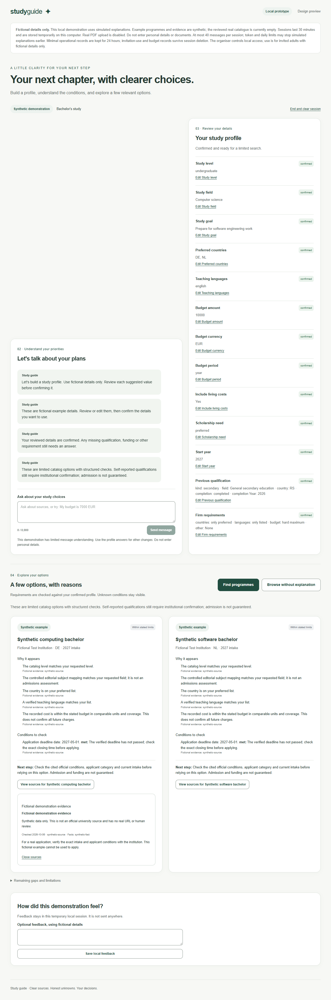
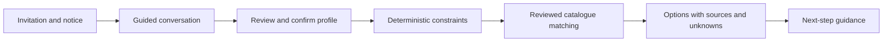

# University Guidance Prototype

An English-only educational guidance prototype that helps prospective students clarify their study goals, compare reviewed university programmes and understand the evidence behind each result.

> **Current status:** Phase 1 prototype complete. The hosted preview is invite-only and currently runs in safe mock mode. It is a demonstration system, not an admissions service or a production release.

[View the controlled preview](https://university-guidance-prototype-production.up.railway.app) · [Read the Phase 1 closeout](docs/PHASE_1_CLOSEOUT.md) · [See the demo script](docs/demo/DEMO_SCRIPT.md)



## What it demonstrates

- A guided conversation for undergraduate, master's and PhD study goals.
- Explicit profile review and confirmation before programme matching.
- Deterministic hard-constraint checks that the AI layer cannot override.
- A controlled catalogue with visible official sources, unknowns and conflicts.
- Explainable programme cards without admission probabilities or guarantees.
- Permission before showing an alternative that departs from a stated preference.
- Server-side AI integration with strict structured output validation and spend guards.
- Invitation-based sessions, quotas, expiry and clear-session controls.
- Responsive, keyboard-accessible flows for desktop and mobile layouts.

The published catalogue snapshot contains eight human-reviewed programmes, 31 official sources, 145 facts and 128 evidence links. Individual eligibility, fee category, total cost and funding remain manual or unknown unless supported by candidate-specific evidence.

## Product flow



The model may propose profile values and explanations. The server validates every proposal, programme identifier and source reference before anything reaches the interface. Programme facts come from the controlled catalogue, not from model memory.

## Technology

- Next.js 16 and React 19
- TypeScript and Zod
- Tailwind CSS
- Vitest and Playwright
- SQLite-backed invitation, quota and spend controls
- OpenAI Responses API behind a server-only, explicitly enabled provider boundary
- Docker deployment on Railway

The prototype is intentionally a single Next.js application. It does not use a microservice, agent-framework or vector-database architecture.

## Run locally

Requirements:

- Node.js 24.x
- npm 11.x

```bash
npm ci
npm run dev
```

Open `http://127.0.0.1:3000`.

The default configuration is local and mock-only. It does not require an API key or make paid model calls. Copy settings from `.env.example` only when you need to change the documented local configuration. Never commit `.env.local` or an API key.

For a production build:

```bash
npm run build
npm run start -- --port 3000
```

## Verification

```bash
npm run format:check
npm run lint
npm run typecheck
npm test
npm run build
npm run test:boundary
npm run test:ai-boundary
npm run catalog:check
```

The repository includes unit, integration, browser, catalogue, AI-contract and server-boundary checks. Verification reports describe the exact scope and limitations of each result; a passing mock test is never presented as proof of live-model quality.

## Repository map

```text
src/                 Next.js application and server controls
data/catalog/        Staging, review and published catalogue snapshots
db/                  Database schema and migrations
scripts/             Offline validation and operator tools
tests/               Unit, integration and browser checks
docs/architecture/   System design and trust boundaries
docs/ai/             AI contract, grounding and verification
docs/data/           Catalogue model, sources and review evidence
docs/demo/           Demo script, screenshots, recording and limitations
docs/security/       Security and privacy baseline
docs/testing/        QA, accessibility and known limitations
```

Useful technical references:

- [Architecture](docs/architecture/ARCHITECTURE.md)
- [Trust boundaries](docs/architecture/TRUST_BOUNDARIES.md)
- [AI contract](docs/ai/AI_CONTRACT.md)
- [Matching algorithm](docs/matching/ALGORITHM.md)
- [Catalogue data model](docs/data/DATA_MODEL.md)
- [Security and privacy baseline](docs/security/SECURITY_PRIVACY_BASELINE.md)
- [Known limitations](docs/demo/KNOWN_LIMITATIONS.md)

## Safety and scope

- The interface and conversation are English-only.
- The preview accepts fictional demonstration data only.
- Document upload and real applicant data are disabled.
- Results do not promise admission or calculate an admission probability.
- Institutional requirements remain authoritative.
- Unknown, conflicting and stale facts stay visible instead of being guessed.
- API keys remain server-side and are excluded from the repository.

See [SECURITY.md](SECURITY.md) for vulnerability reporting.

## Author

Created and maintained by **Viktor Đurov**.

## Copyright and permitted use

Copyright © 2026 Viktor Đurov. All rights reserved.

This repository is public for inspection and portfolio demonstration. It is **not open source**. GitHub users may view and fork the repository as permitted by GitHub's Terms of Service, but no additional permission is granted to use, copy, modify, distribute, sublicense, sell, deploy or create derivative works from the code or project materials. See [LICENSE](LICENSE) for the complete terms.
