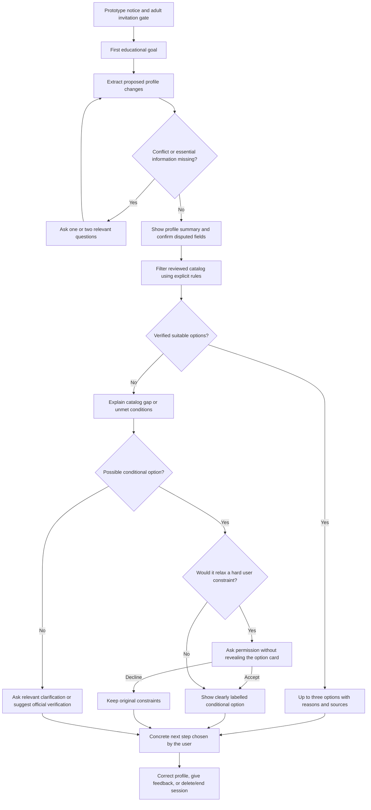

# Korisnički tokovi prototipa

Dopuna 2026-10-06: Korak 6 implementira [profil/pitanja](profile/PROFILE_MODEL.md) i [sintetički replay](profile/CONVERSATIONS.md) izvan UI-ja. Opis primarnog produktnog toka ispod ostaje specifikacija; slobodan chat, matching, AI, sesije i kompletna integracija još nisu implementirani. [Dokaz domena](profile/VERIFICATION.md).

Verzija: 1.0, 2026-10-05. Status: specifikacija Koraka 2; Korak 4 prikazuje sintetički UI deo kroz [stanja](ui/UI_STATES.md) i [provere](ui/VERIFICATION.md), bez pravog domena/AI/sesija. Osnova: [PRODUCT](PRODUCT.md), [PROTOTYPE_SCOPE](PROTOTYPE_SCOPE.md) i odluka D-002 iz DECISIONS (private development record). Interfejs, pitanja, sistemske poruke i razgovor proizvoda su samo na engleskom; ovaj radni dokument je na srpskom. Jezik nastave programa je zaseban podatak.

## Primarni korisnik i posao

Pozvani punoletni kandidat za osnovne, master ili PhD želi da pronađe nekoliko obrazovnih opcija u Srbiji/EU koje odgovaraju njegovom cilju, da razume izvore i ograničenja i da zna šta da proveri/pripremi sledeće. Za razvoj i javni demo koristi se sintetički profil. Pravi pilot čeka kapije privatnosti, izolacije i budžeta iz SCOPE; pozivnica nije javna registracija.

Primarni tok je tekstualan. Upload nije potreban da bi se tok završio i ostaje isključen dok posebna kapija ne prođe. Nema stvarnih programa u katalogu danas. Ova specifikacija ne tvrdi da preporuke ili sesije već rade.

## Mapa od prve poruke do sledećeg koraka

Nezavisno od dijagrama, istekla/obrisana sesija zaustavlja sve zaštićene radnje. Greška servisa ili limit ne otkriva podatke, ne proizvodi lažni uspeh i ne pokreće nekontrolisane pozive.

## Koraci i ugovor ponašanja

| Korak | Ulaz / radnja | Šta korisnik vidi | Uslov prelaska |
| --- | --- | --- | --- |
| F-01: Ulazak | Pozivnica i potvrda da je korisnik punoletan; u demo-u sintetički režim. | AI oznaka, ograničeni katalog, domen, pravila podataka i engleski jezik. | Pozivnica/sesija validna i adult tok dozvoljen. Ne tražiti ličnu kartu ili tačan datum rođenja radi ovog koraka. |
| F-02: Prva poruka | Cilj u slobodnom tekstu, npr. „I want to study biology in the EU.“ | Poruka i najviše dva pitanja koja stvarno menjaju sledeću odluku. | Namera je obrazovna; nedostajuće podatke ne popunjavati nagađanjem. |
| F-03: Profil | Predložene vrednosti uz poreklo i status. | Pregled nivoa, oblasti, lokacije, jezika nastave, budžeta, kvalifikacije, intake-a i finansiranja; nepoznate stavke označene. | Izričita korisnička tvrdnja može biti „user stated“; sporna ekstrakcija ili zaključak traži potvrdu. |
| F-04: Razjašnjenje | Odgovor, korekcija ili „I don't know“. | Jedno/dva ciljna pitanja; postojeći potvrđeni podaci sačuvani. | Uklonjen konflikt ili dovoljno informacija za konkretan filter. Nepoznato može ostati samo uz ograničen rezultat bez tvrdnje o tom uslovu. |
| F-05: Pretraga | Potvrđeni korisnički uslovi i verzija kataloga. | „Searching the reviewed catalog…“, zatim pravi ishod; bez proizvoljnog traženja programa van kataloga. | Deterministički filter, provera institucionalnih uslova i kvaliteta činjenica. |
| F-06: Rezultat | Programi koji prođu proveru ili praznine. | Do tri primarne opcije, izvori/praznine i razlozi; odvojena uslovna opcija ili jasno odsustvo odgovarajuće opcije. | Samo poznati program/source ID; up-to-date relevantni podaci, bez izmišljenog trećeg rezultata. |
| F-07: Sledeći korak | Korisnik otvara opciju ili traži pojašnjenje. | Jedan konkretan korak i razlog: proveriti određeni uslov, pogledati zvaničan način prijave ili pripremiti traženi podatak. | Korak odgovara poznatim činjenicama; nema automatskog slanja, upisa ili garancije. |
| F-08: Korekcija / kraj | Korisnik menja polje, daje feedback ili briše sesiju. | Potvrđena korekcija, ponovno filtriranje ili potvrda obrisane sesije nakon stvarne operacije. | Promena poništava stare rezultate i nevažeće dozvole za alternative; brisanje nije tvrdnja o provider kopijama. |

## Minimum profila i spremnost

Opšti profil ima: punoletni tok/pristup, nivo studija, oblast ili dovoljno jasno interesovanje, dozvoljene/isključene zemlje, jezike nastave koje korisnik može koristiti, ciljnu godinu/intake ili eksplicitno „undecided“, prethodnu kvalifikaciju i njen status, budžet i potrebu za finansiranjem. Ne traži ime, adresu, passport ID ili tačan datum rođenja.

Budžet se predstavlja kroz iznos ili jasno „unknown“, valutu, period (godišnje/ukupno), obuhvat (tuition/living/total) i čvrstoću limita. Godišnji i ukupni iznos se ne porede direktno bez poznatog trajanja/konteksta. Državljanstvo, zemlja kvalifikacije, prebivalište, predmeti ili jezički rezultat pitaju se samo kada menjaju konkretan institucionalni uslov, kategoriju školarine ili finansiranje; ne zaključivati ih iz jezika poruke.

„Spreman profil“ znači spreman za određenu pretragu, ne dokaz da korisnik ispunjava sve uslove prijema. Ako korisnik ne zna budžet, mogu se istražiti relevantne opcije bez oznake finansijske usklađenosti. Ako poznati čvrst budžet zavisi od nepoznatih životnih troškova, odgovarajuća opcija ne sme postati finansijski potvrđena. Svi podaci ne moraju biti poznati, ali ne sme ostati konflikt koji menja primarni filter.

Status polja je odvojen od vrednosti: `user_stated`, `extracted_unconfirmed`, `user_confirmed`, `missing`, `conflicting`. „Unknown“ koji je korisnik izričito naveo nije izmišljen broj i ne mora izazvati ponavljanje istog pitanja. Dokument se ne koristi za ažuriranje spornog polja dok korisnik ne potvrdi izdvojene stavke.

## Varijante prema nivou

| Varijanta | Obavezno razjašnjenje za relevantnu odluku | Primer prva dva pitanja na engleskom | Posebna granica |
| --- | --- | --- | --- |
| UG - osnovne | Srednjoškolska kvalifikacija i zemlja, završeno/u toku, relevantni predmeti/rezultati, jezik ili test ako program traži; potreba za pripremnom rutom. | “What would you like to study, and when do you plan to start?” Zatim, po potrebi: “Which school qualification will you have, and in which country?” | Punoletnost i kvalifikacija su različite stvari. Pripremna/integrisana ruta ne postaje običan master program. |
| MA - master | Prethodna diploma i oblast, zemlja/sistem kredita, relevantni preduslovi, cilj: specijalizacija/promena oblasti/istraživanje. | “What is your previous degree, and are you looking to specialise or change fields?” | Želja za promenom oblasti ne poništava obavezne predmete. Ne tvrditi da ECTS sami dokazuju podobnost. |
| PHD - doktorske | Istraživačka tema i iskustvo, prethodni stepen, otvoreni program ili oglašena pozicija, obavezno finansiranje, mentor/projekat, proposal ako potreban. | “What research topic interests you, and do you need a funded position?” | Razlikovati program, zaposlenje na PhD poziciji i finansiranje; ne sugerisati izmišljenog mentora ili otvorenu poziciju. |

Tri varijante dele isti princip izvora/ograničenja, ali ne dele identičnu listu pitanja. Sva konkretna institucionalna pravila dolaze iz kataloga, ne iz opšteg stereotipa o nivou.

## Četiri vrste uslova

| Vrsta | Primer | Ko može promeniti | Uticaj na pretragu / prikaz |
| --- | --- | --- | --- |
| Čvrsto korisničko ograničenje | “Only Serbia”; “My total annual budget must stay under EUR 8,000.” | Korisnik eksplicitnom izmenom ili konkretnom dozvolom alternative. | Primarni filter; ne kršiti radi više opcija. Dozvola je uska, ne opšta promena celog profila. |
| Fleksibilna preferenca | “A smaller city would be nice.” | Korisnik. | Rangiranje među opcijama koje prolaze filtere; odstupanje objasniti, ne predstavljati kao ispunjenu želju. |
| Institucionalni uslov | Obavezna prethodna diploma/predmet, jezički minimum ili rok za relevantni intake. | Institucija kroz provereno pravilo, ne korisnik ili AI. | Poznato neispunjenje isključuje prikaz kao odgovarajuće. Opcija može služiti samo objašnjenju prepreke, bez obećanja upisa. |
| Nepoznat podatak | Nije poznata valuta, kategorija školarine, finansiranje ili aktuelni rok. | Korisnik za svoj podatak; proveravač/zvaničan izvor za institucionalni. | Ne računati kao ispunjeno. Pitati ako je kritičan profilni podatak; institucionalni nedostatak označiti „needs verification“. |

## Stanja i šta korisnik vidi

Ovo su produktna stanja, ne izbor baze ili API implementacije. Jedan ekran može imati više lokalnih ishoda: dve pouzdane kartice i upozorenje da je izvor za treću nepotvrđen. Globalne blokade imaju prioritet; loš izvor jedne opcije ne skriva validne druge.

| ID / stanje | Okidač i sledeće ponašanje | Šta korisnik vidi na engleskom | Dozvoljen izlaz / naredni prelaz |
| --- | --- | --- | --- |
| S-01 NEW_USER - novi korisnik | Nema važećeg profila; nakon dozvoljenog pristupa tražiti obrazovni cilj. | “This prototype uses a limited, reviewed catalog for Serbia and the EU. What would you like to study?” | S-02, S-03 ili S-04; bez preporuke iz praznog profila. |
| S-02 NEEDS_INFORMATION - nedovoljno informacija | Nedostaje podatak koji određuje konkretan filter. | “Is that budget annual or for the whole degree, and does it include living costs?” | Ciljano pitanje; odgovor → S-03/S-04 ili ostaje S-02. |
| S-03 PROFILE_CONFLICT - konfliktni podaci | Dve različite važne tvrdnje bez jasne eksplicitne korekcije. | “You said ‘only Serbia’ and later ‘only Germany’. Which should I use?” | Prikaz spornog polja, bez tihe zamene; potvrda → S-02/S-04. |
| S-04 PROFILE_READY - spreman profil | Dovoljno za navedenu pretragu, bez kritičnog konflikta; eksplicitne nepoznanice sačuvane. | “Here is the profile I will use. You can correct it before we search.” | Pravila → S-05/S-06/S-07/S-08/S-09; nije ocena prijema. |
| S-05 MATCH_FOUND - odgovarajući program | Najmanje jedan provereni kandidat prolazi čvrsta ograničenja i poznate obavezne uslove; nema nerešenog kritičnog uslova za tu oznaku. | “These options meet the constraints we could verify. Admission is not guaranteed.” + kartice sa izvorima. | 1-3 primarne opcije i sledeći korak. Nekritične praznine se navode; korekcija → S-02/S-03/S-04. |
| S-06 NO_MATCH - nema odgovarajućeg programa | Nema validne primarne opcije; razlikovati prazni/slabo pokriveni katalog od poznatog neispunjenja. | “I couldn't find a verified match in this catalog. This does not mean no suitable program exists.” | Razlog, praznine i korak zvanične provere; moguće S-08. Nikad globalna tvrdnja da opcija ne postoji. |
| S-07 CONDITIONAL_OPTION - uslovna alternativa | Postoji poznata relevantna opcija, ali finansiranje/nekritičan uslov traži proveru ili je konkretno odstupanje već odobreno; poznato neispunjen institucionalni minimum je i dalje prepreka. | “Conditional option: funding has not been confirmed. Check the official funding conditions before relying on this option.” | Odvojena kartica, jasno odstupanje/praznina, bez potvrđenog fit-a ili automatskog menjanja primarnih preporuka. |
| S-08 ALTERNATIVE_PERMISSION_REQUIRED - dozvola za alternativu | Potencijalna opcija van jednog čvrstog korisničkog uslova, unutar Srbije/EU; nije poznato da krši obavezni institucionalni minimum. | “There may be an option in Italy, outside your selected countries. Would you like to explore it?” + Yes/No. | Pre dozvole nema programskog naziva/kartice ni nametnutog izvora te opcije. Yes → S-07 uz scoped dozvolu; No → ostaje prvobitni obim. |
| S-09 SOURCE_UNVERIFIED - nepouzdan izvor | Kritična institucionalna činjenica nema aktuelan/relevantan autoritet, konfliktna je ili zastarela. | “The requirement for this intake has not been verified. Please check the official admissions page.” | Bez tvrdnje/oznake da uslov važi ili da je kandidat podoban. Pouzdani drugi rezultati ostaju; korak provere, ne lažni rok. |
| S-10 SERVICE_ERROR - greška servisa | Timeout, refusal, invalid/nepotpun izlaz ili nedostupan servis; rezultat nije potvrđen. | “The AI service is unavailable. You can still review the catalog and the last confirmed profile.” | Sačuvati potvrđeni profil; bez automatskog uspeha ili beskonačnog retry. Ponovni pokušaj uz važeću sesiju/kvotu. |
| S-11 SESSION_EXPIRED - istekla sesija | Istek ili brisanje otkriven pre/posle zahteva. | “Your session has expired. Start a new session to continue.” | Bez prikaza zaštićenog profila/razgovora i bez vraćanja obrisanih podataka; novi dozvoljeni pristup → S-01. |

Dodatne zaštitne poruke iz postojećeg obima: nevezana tema → “I can help with study choices, program requirements and related application steps.”; punoletni tok nedozvoljen → “This pilot is for adults only.”; finansijska kvota → “The AI limit has been reached. You can still review the catalog.” Nema novih opštih chatbot funkcija. Obrazovni izlaz ne sme sadržati falsifikovanje ili procenat prijema.

## Redosled odluke i pravila povratka

1. Pre zaštićene radnje proveriti dozvoljeni pristup, sesiju, validnost ulaza i kvotu. Istek ima prednost nad rezultatom zahteva. Out-of-scope ili nedozvoljen unos ne pokreće preporučivanje.
2. Potvrditi nameru i predložene izmene profila. Jasna poruka “Change my budget to…” je eksplicitna korekcija; nepovezana suprotna tvrdnja je konflikt. Sporna ekstrakcija nije automatski korekcija.
3. Konflikt koji menja filter → S-03; zatim neophodni nedostajući profilni podatak → S-02. Ne tražiti svih deset polja unapred ako je ranije dovoljan manji skup za ciljano pitanje.
4. Spreman profil → deterministička pretraga. Poznato neispunjen institucionalni minimum isključuje odgovarajuću/odobrenu alternativnu preporuku. Nepoznat kritičan institucionalni uslov → S-09, ne “no eligible students”.
5. Prvo primarne proverene opcije S-05. Uslovne su odvojene S-07; ako traže promenu čvrstog uslova, prvo S-08. Ako nema primarnog rezultata, objasniti tačan razlog S-06 uz lokalne S-09 oznake ako postoje.
6. Promena profila poništava rezultate za staru verziju i dozvole kojima su se promenili relevantni uslovi. Odbijena ili opozvana dozvola uklanja alternativnu karticu; originalni hard uslov ostaje. Šira promena zemlje ne sme proširiti Srbiju/EU.
7. Ako servis zakaže, ne primenjivati nepotvrđenu izmenu i ne prikazivati nevalidan izlaz. Bezbedno prikazati već potvrđene katalog podatke, uz datum; istekla sesija nema ovaj izuzetak.

## Kartica i konkretan sledeći korak

Kartica ima identitet institucije/programa, nivo/tip PhD opcije, zemlju/grad, jezik nastave, razloge vezane za profil, poznate uslove i troškove s jedinicom/kategorijom kandidata, rok samo za provereni intake, nepoznate stavke, izvore povezane s ključnim tvrdnjama, datum provere i jedan konkretan korak. Izvorni naziv programa se čuva. Fit se objašnjava razlozima, bez admissions score-a.

Primeri produktnog teksta: “Check whether your previous degree meets this prerequisite.”; “Confirm the fee for your applicant category.”; “Review the official application instructions.” Ne govoriti “Apply by…” kada rok nije verifikovan. Korisnik sam preduzima spoljnu radnju.

## Veze za implementaciju i proveru

[USER_STORIES](USER_STORIES.md) daje obavezna ponašanja, [PROTOTYPE_ACCEPTANCE](PROTOTYPE_ACCEPTANCE.md) način provere, a [SYNTHETIC_PROFILES](test-fixtures/SYNTHETIC_PROFILES.md) ponovljive profile. Ovo je ugovor ponašanja za buduće korake, bez zaključavanja konkretne baze, AI modela, UI komponenti ili kvota.

