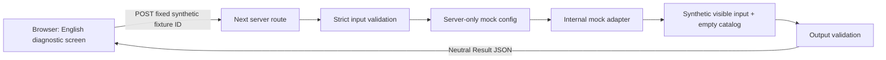

# Kontekst aplikacije

Datum: 2026-10-05. Trenutno lokalni tehnički kostur i sintetički statički UI; planirani proizvod je obrazovni savetnik iz [PRODUCT](../PRODUCT.md). [Arhitektura](ARCHITECTURE.md) razlikuje implementirano od planiranog; D-002 zadržava samo engleski UI/razgovor.

## Sadašnji obrazovni UI na /

Korisnik → lokalni StudyWorkspace React state → UI-only sintetički brief/poruke/kartice/izvori. Obrazovni walkthrough nema API poziv niti pohranu; reload resetuje state. Promena profila uklanja fiksne opcije, a dozvola kontroliše samo prikaz javne ilustracije. Server katalog ostaje prazan. [UI matrica](../ui/UI_STATES.md) i [dokaz](../ui/VERIFICATION.md). Dijagnostički tok ispod je zaseban i ne obrađuje chat.

## Tehnička dijagnostika na /technical

Browser i server pripadaju jednoj aplikaciji, ali imaju različite dozvole i poverenje. Zahtev ne sadrži slobodan chat, upload ili lične podatke. Nema sačuvanog profila/sesije, spoljnog HTTP poziva, cloud baze, AI potrošnje ili programskih preporuka. `GET /api/health` proverava samo tehničku spremnost. Statički početni ekran sam po sebi ne garantuje validnost server okruženja; to proveravaju rute.

## Planirani kontekst

Punoletni pozvani kandidat će kasnije razgovarati sa aplikacijom; pravila i pregledani katalog određuju podobnost i filtriranje, a jedan AI adapter ograničeno predlaže ekstrakciju/objašnjenje. UI koristi interne ugovore i server rute. PostgreSQL/Supabase čuva relacioni katalog i provereno izolovane sesije tek nakon odgovarajućeg dizajna. OpenAI Responses API ostaje spoljašnji serverski dobavljač iza adaptera, bez direktne browser veze. Zvanični izvori ulaze u kontrolisani katalog kroz pregled, ne automatsko poverenje ili otvoren URL-fetch alat.

Dokumenti i modelovi odgovori ne mogu davati sistemske instrukcije, otvarati nove dozvole ili ukidati institucionalne uslove. Pravi upload je isključen. Modelovi nazivi/cene iz PDF-a nisu aktivna konfiguracija. Broj planiranih programa/intervjua/evaluacija nije ostvaren rezultat. Geografija ostaje Srbija/EU, a jezik nastave je zasebno polje u budućem profilu.

## Operativni okvir

- Lokalni proces na loopback adresi, bez objavljivanja. Dev server za rad; production build/start za ponovljiv browser test.
- Jedan npm manager/lockfile, jedan kodni projekat, bez dodatnih servisa.
- Razvojni dependency download koristi npm/CDN; to nije mrežni poziv aplikacije. Mock aplikacija ne koristi te servise u runtime-u.
- Nema GitHub remote-a niti uslovnog CI naloga. Git/versioning je otvoren tehnički dug, ne razlog za izmišljeni CI PASS.
- Pravi pilot zahteva završene kapije privatnosti/sesija/kvota/bezbednosti/budžeta. Ovaj kostur nije spreman za stvarne lične podatke ili javnu upotrebu.

Trenutne provere i neuspešni pokušaji: [VERIFICATION](VERIFICATION.md). Buduće kapije: izvršni plan (private development record), OPEN_QUESTIONS (private development record).
