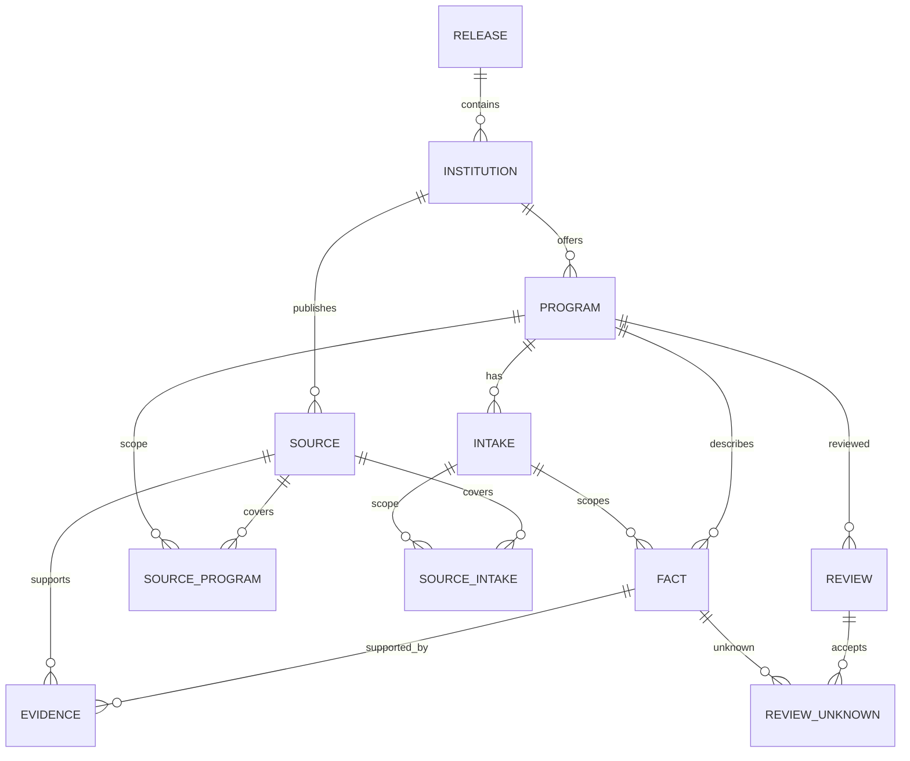

# Model kontrolisanog kataloga

Post-closeout napomena 2026-10-17, D-043/D-044: isti model sada čuva originalni staging i approved published 1.0.3 sa osam programa/31 official izvorom/145 činjenica/26 visible unknown. Nema cloud baze; [aktuelni završni status](../PHASE_1_CLOSEOUT.md). Donji uvod opisuje stanje Koraka 5.

Korak 5, 2026-10-06. Osnova: Prompt 5 i Master plan str. 29, 33, 40–43, 87. Jedna buduća PostgreSQL baza; lokalni razvoj sada koristi dva verzionisana JSON snapshot-a. Nema cloud naloga, konekcije, korisničkih podataka, matching-a ili publikacije.

[Zod/TS ugovor](../../src/features/catalog/schema.ts), [semantička provera](../../src/server/catalog/validation.ts), [serversko čitanje](../../src/server/catalog/local-repository.ts), [SQL model](../../db/migrations/001_catalog.sql). Stari `CatalogRepository` je mali port za praznu mock dijagnostiku; novi snapshot nije spojen s njim ili sa sintetičkim UI-jem.

## Entiteti i veze

Institution ima ime, zemlju i pregledane publisher domene. Program ima svoj ID, institution FK, normalizovani naziv/nivo/zemlju/grad i uredničku oblast/podoblast. Kopije identiteta služe čitanju i moraju odgovarati pojedinačnim, potkrepljenim identity facts. Urednička klasifikacija nije zvanična akreditaciona klasifikacija.

Intake razlikuje akademsku godinu i konkretnu rundu od opšte politike. `general_policy` s null godinom ne potvrđuje budući upis. Svaki intake ima academic_year, intake_start, tuition i application_deadline fact ili eksplicitni unknown. Programi mogu imati više ciklusa bez prepisivanja prethodnog. Fixture ima po jedan pažljivo označen kontekst za svaki program.

Fact je tvrdnja o jednom polju/pravilu, sa qualifier-om, kategorijom kandidata, prirodom, datumom i statusom. Različite valute/periodi, EU/non-EU kategorije ili godine nisu isti uslov. Više zahteva su više facts. Jezik nastave je odvojen od English-only interfejsa. Poznat trošak je strukturisani money sa valutom, periodom i osnovom; troškovi nisu unapred sabrani u total-degree budžet.

Source čuva URL/publisher/authority/status/datume i eksplicitni program/intake scope. Evidence povezuje fact i source, navodi odeljak ili PDF stranu i kratku parafrazu. `supports` nije isto što i `context`; stranica proverena bez pronađenog podatka ne dokazuje izmišljenu vrednost. Više izvora može potkrepiti jednu tvrdnju; nema opšteg program-URL koji automatski potvrđuje sve podatke.

Review čuva odluku čoveka ili agenta, pregledani digest, checklist i pojedinačno prihvaćene unknown facts. Agentova provera izvora nije human approval. Produkcioni fixture reviews su prazni.

## Verzije, SQL mapiranje i granice

JSON `schemaVersion` = ugovor, `version` = sadržaj, `channel` = staging/published. [Staging](../../data/catalog/staging/catalog.v1.json) sadrži osam programa; [published](../../data/catalog/published/catalog.v1.json) ima nula programa. SQL svaki entitet vezuje za release; kompozitni FK sprečava pozivanje entiteta iz druge verzije/kanala. Source program/intake nizovi postaju spojne tabele; `acceptedUnknownFactIds` postaje review_unknowns. JSON null value mapira se na SQL NULL, ne JSONB `null`.

SQL je PostgreSQL kompatibilan relacioni dizajn sa FK/check/index ograničenjima, privatnom schema i RLS bez grant-a/policy-ja. Nije izvršen: nema lokalnog `psql`/potvrđenog engine-a. SQL sam ne proverava sve money strukture, URL authority, semantički smisao parafraze, svežinu ili human digest. Obavezan je aplikacioni validator pre eventualnog uvoza; budući importer/DB publication transakcija nisu implementirani. DB owner može zaobići RLS; ovo nije dokaz session/cloud bezbednosti.

## Čitanje i objavljivanje

`readLocalCatalog(channel, asOf)` eksplicitno bira kanal, validira i baca bezbednu grešku kod neispravnosti. Ne vraća staging kada je published prazan. Nema novog javnog endpoint-a. Validator i CLI ne preuzimaju URL-ove, ne izvršavaju web instrukcije i ne menjaju podatke.

Za published je potrebno: validna šema i sve reference; bez unsourced, unverified, stale ili conflicting poznatih tvrdnji; aktuelno ljudsko odobrenje kompletne verzije za svaki program, kompletna checklist i eksplicitno prihvatanje vidljivih unknown. Digest SHA-256 pokriva sve podatke/verziju osim reviews i destination channel-a; izmena bilo koje tvrdnje/izvora/napomene poništava odobrenja. To je detekcija izmena, ne digitalni potpis ili autentifikacija čoveka; stvarni kontrolisani workflow treba rešiti pre live pohrane. Nema komande za automatsku promociju.

Potpuno verifikovan program nema unknown/neproverene/konfliktne/stare tvrdnje i ima fresh dokaze za sve obavezne činjenice. Svi novi programi su `partial`. Delimičan pregledan program može kasnije biti published uz eksplicitne unknown; ne može se predstavljati kao potpuno podoban kandidatovom profilu. Zatvoren istorijski konkurs može ostati dokumentovan; njegov rok je `closed`, nikada novi aktivni rok.

Detalji: [rečnik](DATA_DICTIONARY.md), [izvori](SOURCE_AUTHORITY.md), [svežina](FRESHNESS_POLICY.md), [ljudski pregled](CATALOG_REVIEW.md), [svaka tvrdnja i nepoznato](INITIAL_CATALOG.md).
